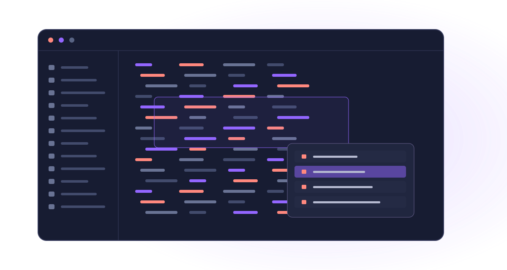

<!-- SPDX-License-Identifier: CC-BY-4.0; code examples: MIT -->

<p align="center">
  
</p>

# Embedded SQL in Java, modernized.

**SQLJ brings static, type-safe, and high-performance SQL directly into Java.  
The `sqlj-lang` IntelliJ plugin provides first-class developer tooling, intelligent code completion, and source-level debugging for modern Java & DB2 enterprise environments.**

---

## What is SQLJ?

SQLJ (ANSI/ISO SQL standard Part 0) allows developers to write static SQL statements directly embedded within Java source code using `#sql` directives. Rather than assembling fragile dynamic SQL strings with standard JDBC, SQLJ delivers:

- **Compile-time validation**: SQL syntax, table structures, and column types are verified before deployment.
- **Type-safe host variables**: Seamless binding of Java fields, parameters, and expressions (`:variable`, `:(expr)`, `:OUT param`).
- **Strongly typed iterators**: Type-safe query result sets via named and positional iterator constructs without manual `ResultSet.getXXX()` calls.
- **Optimized execution plans**: Static DB2 packages and pre-bound database access plans offering predictable, ultra-fast enterprise query performance.

---

## Editor & IDE Experience

<p align="center">
  
</p>

The IntelliJ IDEA plugin transforms `.sqlj` development into a native, high-productivity editing experience:

- **Seamless Syntax Highlighting**: Dual-layer highlighting combining Java keywords, `#sql` directives, SQL clauses, and bind variables.
- **Multi-Host SQL Dialect Injection**: Embedded SQL blocks inside `#sql { ... }` leverage IntelliJ's DB2 SQL dialect with schema inspection and table/column auto-completion.
- **Bidirectional Navigation**: Jump directly between Java declarations and SQL bind variables (`Ctrl+B` / `Cmd+B`).
- **Source-Level Debugging**: Set breakpoints directly in `.sqlj` files, step through code line-by-line, and evaluate live expressions without leaving original sources.

---

## A Complete SQLJ Example

```java
package org.example.payroll;

import java.sql.SQLException;
import java.math.BigDecimal;
import sqlj.runtime.ref.DefaultContext;

public class EmployeeService {

    // Declare a type-safe named iterator
    #sql public static iterator EmployeeIterator(
        long id,
        String name,
        String department,
        BigDecimal salary
    );

    public void processDepartmentBonuses(String dept, BigDecimal bonusPercent) throws SQLException {
        EmployeeIterator employees;

        // Execute embedded query with bind variables into typed iterator
        #sql employees = {
            SELECT id, name, department, salary
            FROM employees
            WHERE department = :dept AND active = 1
            ORDER BY id
        };

        while (employees.next()) {
            long empId = employees.id();
            BigDecimal currentSalary = employees.salary();
            BigDecimal newSalary = currentSalary.multiply(BigDecimal.ONE.add(bonusPercent));

            // Execute in-place update using host variables and parenthesized expressions
            #sql {
                UPDATE employees
                SET salary = :newSalary,
                    last_bonus_date = CURRENT DATE
                WHERE id = :empId
            };

            System.out.printf("Updated employee %s (#%d): %s -> %s%n",
                employees.name(), empId, currentSalary, newSalary);
        }
        employees.close();
    }
}
```

---

## Where to Go Next?

| Your Goal | Recommended Starting Point |
|---|---|
| **Documentation Map** | [Explore the full documentation index](documentation-map.md) |
| **Get Started** | [Installation & Quick Start Guide](user-guide/getting-started.md) |
| **User Guide** | [Read the SQLJ User Guide](user-guide/index.md) |
| **Language Reference** | [Comprehensive SQLJ Syntax & Directive Reference](user-guide/language-reference.md) |
| **IDE Features** | [IntelliJ Editor Insight, Completion & Debugging](user-guide/ide-features.md) |
| **Step-by-Step Tutorials** | [Explore Hands-on Tutorials](tutorials/index.md) |
| **Developer & Architecture Docs** | [Plugin Internals & Contributor Guide](development/index.md) |
| **Maintainer & Source Guide** | [Maintainer Guide, Build Steps & Code Walkthrough](maintainers/index.md) |

---

## Compatibility & System Requirements

- **IntelliJ IDEA**: Build `#261.24374-151` (2026.1+) and compatible JetBrains IDEs.
- **Java Platform**: Java 21 LTS or higher.
- **Database Support**: IBM DB2 for LUW / z/OS, Apache Derby, Oracle Database with SQLJ runtime support.
- **Build Systems**: Gradle, Apache Maven, and IBM DB2 `sqlj` / `db2sqlj` command-line translators.

---

[Public documentation on GitHub](https://github.com/DannyReinhold/sqlj-lang) ·<br>
[Contributing & Architecture](development/index.md) ·  
[Maintainer Guide](maintainers/index.md) ·  
[Development Roadmap](development/development-plan.md) ·  
[Licensing: plugin PolyForm / documentation CC BY](licensing.md) ·<br>
[Legal Notice / Impressum](impressum.md) ·  
[Privacy Notice](privacy.md)
